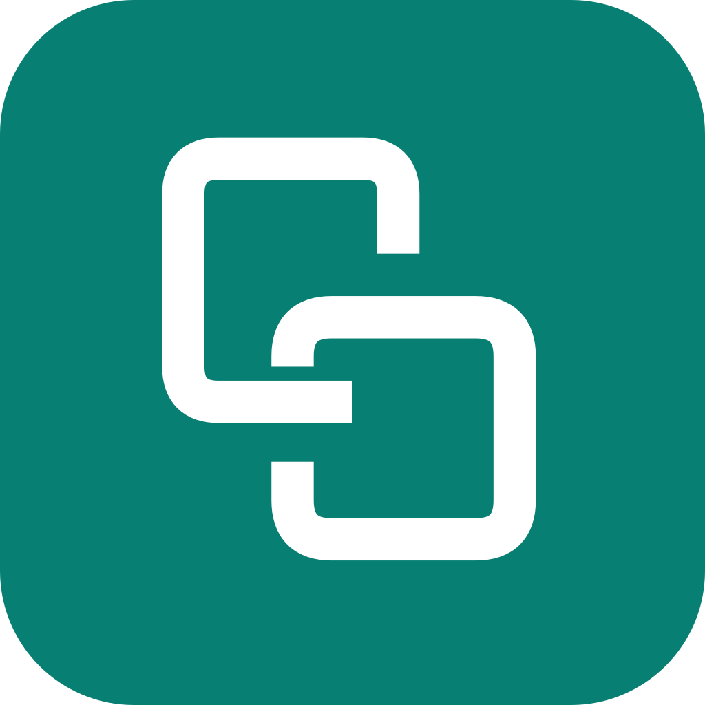

<p align="center"></p>
<h1 align="center">ClipBridge</h1>
<p align="center">Windows 与 Android 多设备端到端加密剪贴板同步</p>

ClipBridge 使用 WebDAV 或自托管 Docker 中转，同步文本、图片和文件。内容在发送设备加密，在接收设备解密；中转保存密文，不持有内容密钥。不兼容原版 SyncClipboard 协议，不提供明文模式。

> 当前正式版本为 **0.6.3**，安装包见 [Releases](https://github.com/li-junlei/ClipBridge/releases/latest)。新增多设备同步组，并修复重新入组、多组显示、重复回传、WebDAV 重复邀请及 Windows 表单顺序。组内所有设备请一起升级。

## 功能

- **任意设备建组**：Windows、Android 均可创建同步组或邀请设备，最多 8 台活跃设备。
- **扫码或配对码加入**：面向手机扫码，面向电脑可手动输入地址和配对码，或粘贴完整邀请；Android 同样支持手动输入。两端分别核对并确认安全码。
- **独立设备身份**：签名成员授权，每对设备派生独立加密密钥，加入后自动建立组内连接。
- **按组管理**：独立开关、成员管理、邀请、退出；首页仅展示状态、接收设备数和最后同步时间。
- **文本与图片**：同步到已开启组中的目标设备；同一签名设备的多条路径合并发送并自动尝试备用路径。Windows 可关闭复制图片自动发送，改用自定义快捷键上传当前剪贴板。
- **文件互传**：Android 系统分享，Windows 托盘或资源管理器右键发送，多选文件，接收方同意后上传；每个文件最多 100 MiB。
- **接收体验**：Android 图片通知预览及保存/丢弃，完成后点击打开文件；Windows 完成通知提供打开文件和所在位置。
- **系统集成**：Windows 安装程序、开机自启动和精简托盘；Android 模块状态、可隐藏桌面入口和独立常驻通知分类。

## 安装要求

| 组件 | 要求 |
| --- | --- |
| Windows | Windows 10/11 x64，安装程序包含 .NET 运行环境 |
| Android | Android 10+ 安装下限，需要可用的 LSPosed 或兼容框架；管理界面与模块合一 |
| 中转 | 支持 HTTPS、Basic 认证与读写目录的 WebDAV，或 Docker 专用中转 |

Android 安装下限不代表所有系统已经验证。模块本身不调用 `su` 或直接请求 root；Hook 框架所需环境由所选框架决定。Windows 安装程序尚未代码签名；Android release APK 保持已有签名以支持覆盖升级。

## 开始使用

1. 两端更新客户端。Android 按模块管理器要求重新加载模块。
2. 任意设备打开“同步组 → 创建同步组”。选择专用中转或 WebDAV，填写地址及所需认证。
3. 选择“邀请设备”，保持页面开启。新设备扫码，或打开“加入同步组”填写同一地址及配对码。
4. 核对两端六位安全码并分别确认。其余成员通常一分钟内发现新设备。

专用中转只有创建组需要服务器管理码。WebDAV 手动配对还需要相同目录、账号和应用密码；完整邀请可自动读取连接信息。邀请包含敏感配对凭据，只能交给自己的设备。

首页显示状态；“同步组”负责成员及开关；设置负责接收目录、轮询、快捷键和系统集成。既有双设备连接不删除、不更换密钥，统一归入双设备组；增加成员需要重新建组和重新验证身份，不能将早期共享密钥直接复制给更多设备。

详见 [同步组指南](docs/GROUPS.md)、[WebDAV 指南](docs/WEBDAV.md) 和 [文件与图片](docs/MEDIA.md)。

## 专用中转

```sh
git clone https://github.com/li-junlei/ClipBridge.git
cd ClipBridge
docker compose -f deploy/compose.yaml up -d --build
docker compose -f deploy/compose.yaml logs relay
```

以上使用检出的源码。服务默认仅绑定 `127.0.0.1:18787`。配置 HTTPS 反向代理，保留 Authorization 请求头，文件请求体上限至少 101 MiB。服务器日志提供创建组所需的管理码，不能公开日志或该凭据。

`/health` 返回 `status: ok`，`/v1/setup/info` 包含 `groups: 1`。升级保留现有数据卷、端口与认证文件。专用中转继续兼容已有双设备组。CasaOS 先构建本地镜像，再修改现有应用的镜像标签，见 [部署指南](docs/DEPLOYMENT.md)。

## WebDAV

无需安装专用服务端。客户端只上传加密消息、加密成员清单和加密附件。新版使用 `clipbridge/groups/` 与 `clipbridge/invites/`，兼容坚果云顶层目录名称限制；旧组保留原存储布局。

WebDAV 是定期检查，不保证实时。设置可调整文本和附件间隔；具体服务商的访问限频及账号流量配额仍适用。错误认证、权限、过期邀请与限频会显示对应提示。第三方服务可能不执行条件写入，客户端会检测已观察到的握手冲突；端到端认证不会依赖它返回的设备列表。

## 安全边界

中转仍可见流量时间、大小、网络地址和部分标识，也可延迟或删除数据。端到端加密不能保护已被控制的终端。Windows 本地私有状态由当前用户 DPAPI 保护，Android 由 Keystore 包装。

成员移出在其他设备收到签名通知后生效，不擦除该设备已拥有的历史内容或密钥，也不自动撤销共用存储访问。彻底撤权需新组及新存储凭据。未实现消息级前向保密，本项目尚未经过独立安全审计。详见 [安全说明](SECURITY.md)。

## 构建与检查

需要 .NET 10 SDK；Windows 安装程序另需 Inno Setup 6（含简体中文）。Android 使用 JDK 17+、Android SDK 37 和仓库内 Gradle wrapper。协议专项需要 Python 与 [测试依赖](tests/requirements.txt)。

```powershell
.\build.ps1
.\installer\build.ps1
cd android
.\gradlew.bat --no-daemon assembleRelease
```

Windows 安装程序输出至 `artifacts/installer/`，以后继续提供安装程序。Android debug 变体仅为独立模拟器检查开放本机 HTTP；分发使用 release APK，继续要求 HTTPS。

```text
src/ClipBridge.Core       加密、组成员、配对及设备间传输
src/ClipBridge.Relay      密文中转和短期邀请
src/ClipBridge.Windows    Windows 客户端
android/                 Android 管理界面及 LSPosed 模块
deploy/                  Docker 和 CasaOS 模板
installer/               Windows 安装程序
tests/                   协议、HTTP、界面及跨平台互操作验证
```

[验证范围](docs/VALIDATION.md) · [协议文档](docs/PROTOCOL.md) · [贡献指南](CONTRIBUTING.md)

技术路线参考 [SyncClipboard Xposed](https://github.com/shaklow/syncclipboard-xposed)，功能设计参考 [SyncClipboard](https://github.com/Jeric-X/SyncClipboard)。界面使用 Miuix，二维码使用 QRCoder 和 ZXing。源码采用 [MIT License](LICENSE)，第三方组件保留各自许可，见 [第三方声明](docs/THIRD_PARTY.md)。
